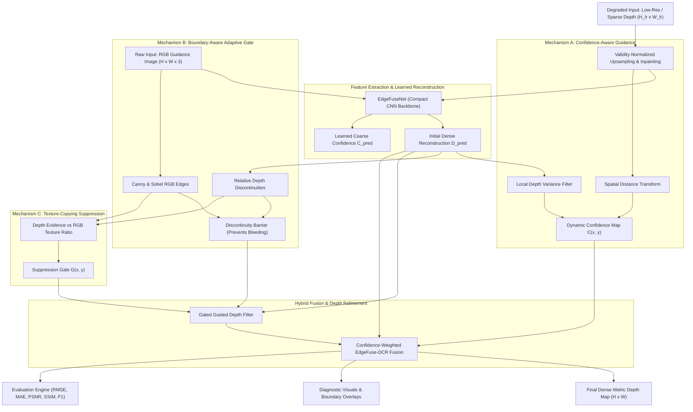

# EdgeFuse-DCR: System Architecture & Design Specification

## P4: Edge-Preserving Depth Map Upsampling and Refinement

### 1. High-Level System Architecture

---

### 2. Core Methodological Contributions

#### Mechanism A: Confidence-Aware Depth Reconstruction
Low-resolution and sparse depth inputs often feature noisy or missing regions. Treating missing zero values as genuine distances causes catastrophic depth bleeding. EdgeFuse-DCR employs:
1. **Validity Mask Tracking**: Separates measured physical points from unmeasured voids.
2. **Spatial Uncertainty Decay**: Confidence decays exponentially with spatial Euclidean distance from measured seeds:
   $$C_{\text{spatial}}(p) = \exp\left(-\frac{\text{dist}(p, \Omega_{\text{valid}})}{\sigma_d}\right)$$
3. **Local Geometric Consistency**: Normalizes standard deviation within a local window:
   $$C_{\text{geom}}(p) = 1.0 - \text{clip}\left(\frac{\sigma_D(p)}{\mu_D(p) + \epsilon} \cdot 4.0, 0, 1\right)$$

#### Mechanism B: Boundary-Aware Adaptive Refinement
Standard bilateral or guided filtering smooths across true depth boundaries if color similarity is high. EdgeFuse-DCR computes depth discontinuities independently:
$$\nabla_{\text{rel}} D = \frac{\|\nabla D\|}{D + \epsilon}$$
Where $\nabla_{\text{rel}} D > \tau_{\text{discon}}$, a barrier penalty attenuates the smoothing radius, ensuring thin object structures and foreground-background step edges are preserved sharply.

#### Mechanism C: Texture-Copying Suppression Gate
RGB texture variations (e.g., patterned wallpaper, wood grain, brick textures) create high RGB gradients where actual geometric depth is completely flat. EdgeFuse-DCR compares the depth gradient evidence against the RGB gradient:
$$G(p) = \begin{cases} 
\text{clip}\left(\frac{\|\nabla_{\text{rel}} D(p)\|}{\|\nabla I(p)\| + \epsilon} \cdot 2.0, 0.05, 0.4\right) & \text{if } \|\nabla I(p)\| > \tau_{\text{rgb}} \text{ and } \|\nabla_{\text{rel}} D(p)\| < \tau_{\text{depth}} \\
1.0 & \text{otherwise}
\end{cases}$$
When false texture is detected, the guidance weight $G(p)$ suppresses RGB edge injection, preventing artificial corrugated artifacts on flat planar surfaces.

---

### 3. Pipeline Stages & Ablation Study

| Level | Component | Key Feature |
| :--- | :--- | :--- |
| **A0** | Classical Interpolation | Nearest, Bilinear (validity-normalized), Bicubic |
| **A1** | Classical Edge-Preserving Filters | Joint Bilateral Filter, Fast Guided Filter |
| **A2** | Deep Learning Backbone | EdgeFuseNet alone (supervised on NYU Depth V2) |
| **A3** | CNN + Confidence Guidance | Dynamic weighting between seed measurements and learned predictions |
| **A4** | CNN + Confidence + Boundary Refinement | Discontinuity barrier preventing edge bleeding |
| **A5** | **EdgeFuse-DCR Full Hybrid** | All above + Texture-Copying Suppression Gate |

---

### 4. Failure-Case Analysis & Limitations
1. **Speculative Reflections & Mirrors**: Highly reflective glass or mirrors exhibit RGB texture that does not correspond to physical surface geometry.
2. **Extreme Sparsity (< 1% LiDAR)**: When seed density is exceptionally low, distance transform confidence falls to near zero, requiring relying primarily on the learned semantic prior.
3. **Heavy Sensor Saturated Flare**: Overexposed RGB regions lose color gradient information, reducing guidance fidelity.

